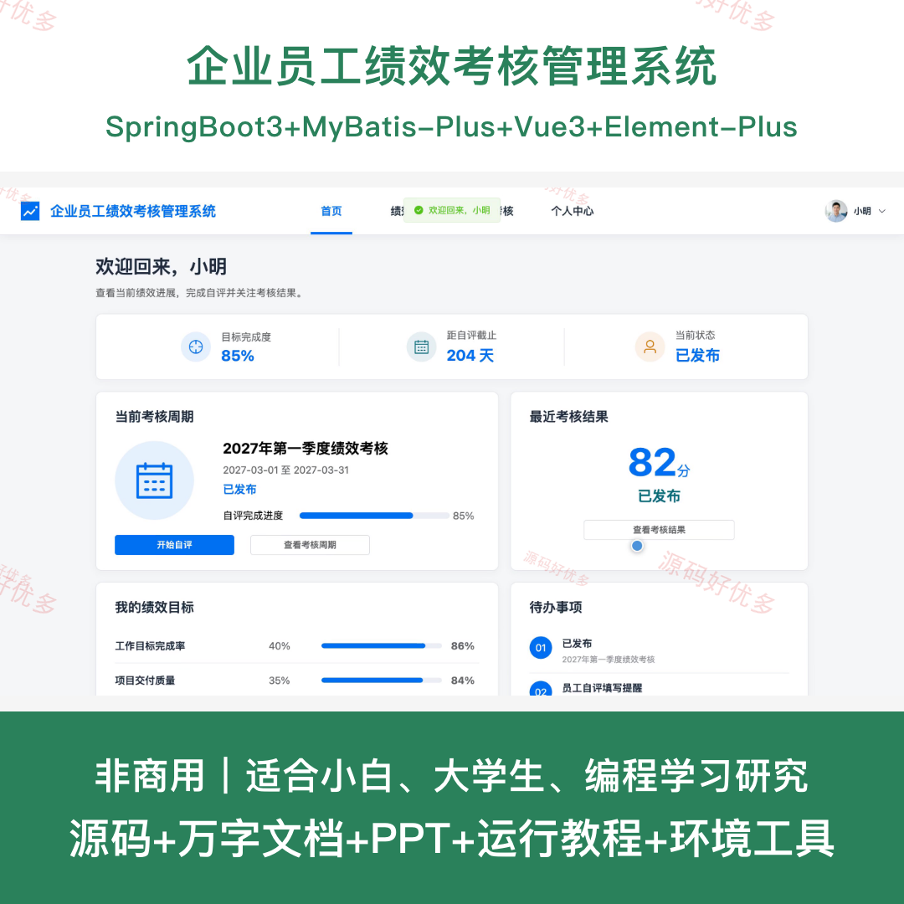
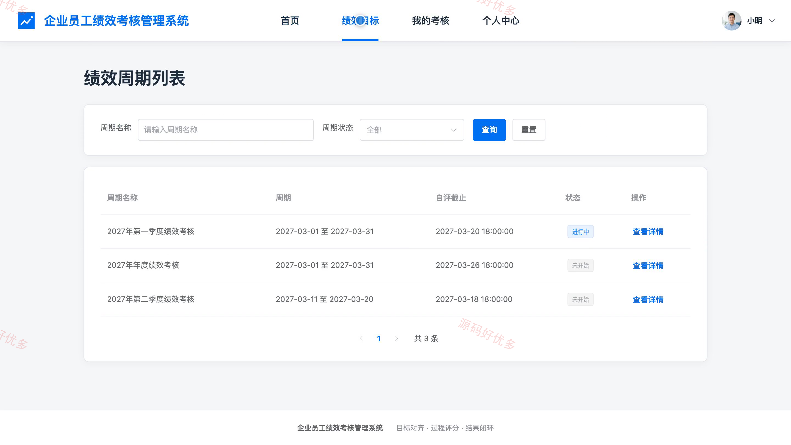
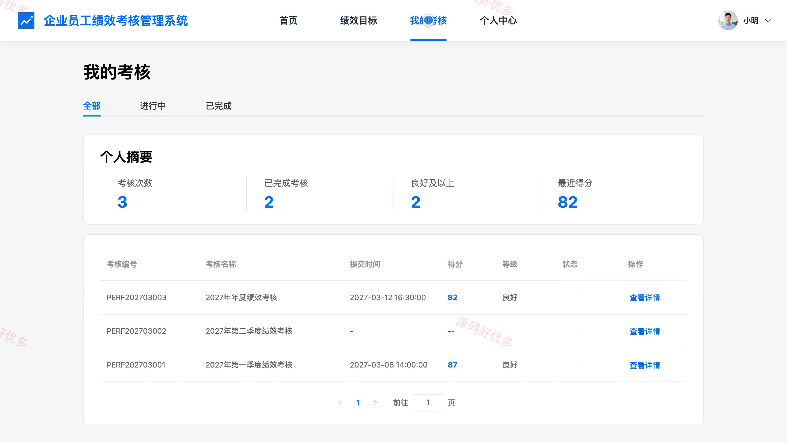
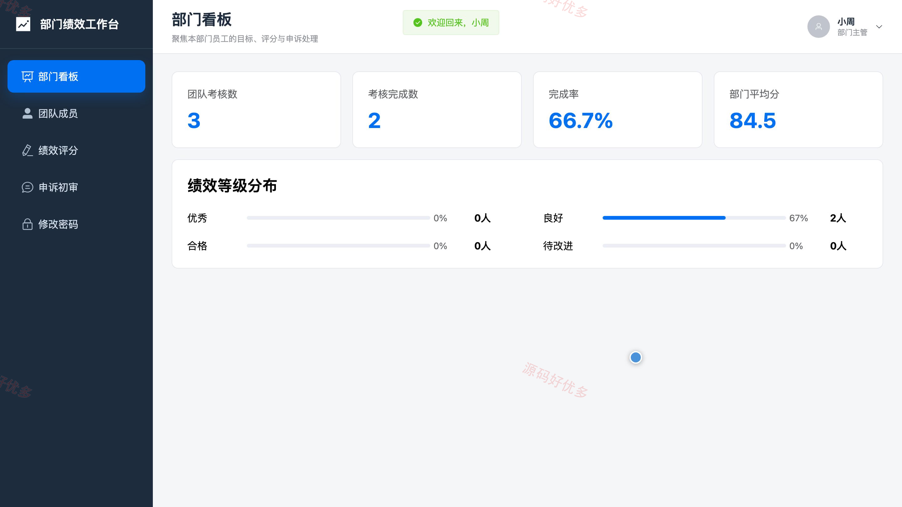
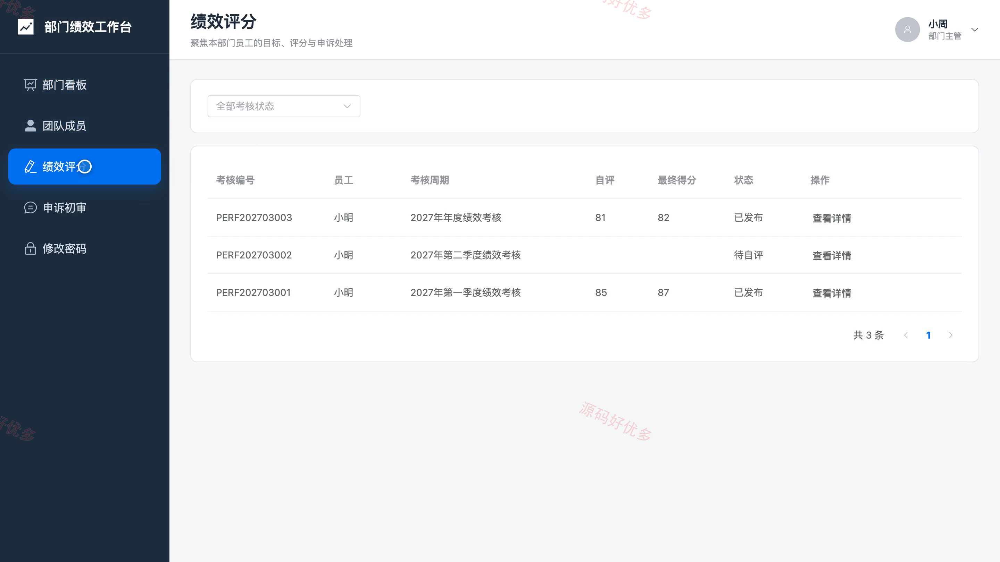
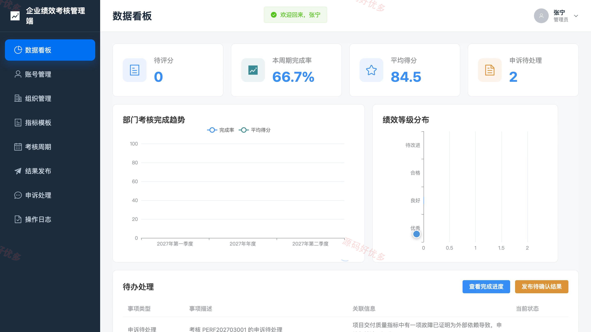
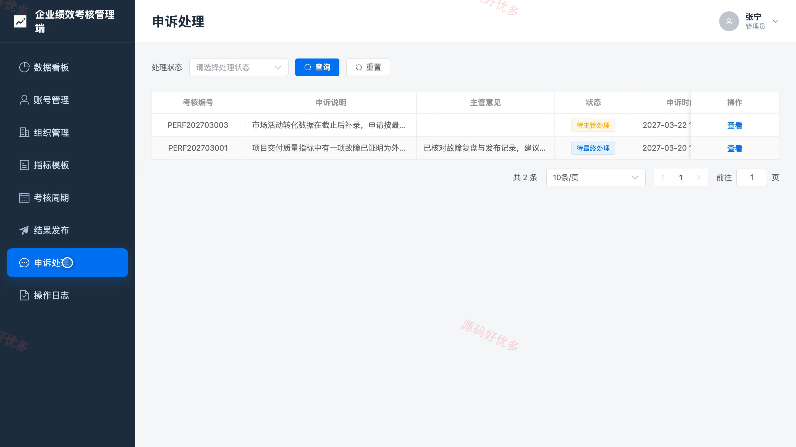

# bs103A
bs103A企业员工绩效考核管理系统
## 源码问题查看主页咨询

### 一、关键词
员工绩效考核、绩效评估、绩效管理、目标管理、考核申诉

### 二、作品包含
源码+数据库+万字设计文档+PPT+全套环境和工具资源+本地部署教程

### 三、项目技术
前端技术： Html、Css、Js、Vue3.4、Element-Plus
后端技术：Java、SpringBoot3.2.0、MyBatis-Plus

### 四、运行环境（以下版本亲测，其他版本兼容性请自行测试）
开发工具：IDEA/eclipse + VSCODE

数据库：MySQL5.7+（共13张表）

数据库管理工具：Navicat10以上版本

环境配置软件： JDK17 + Maven

前端Nodejs：16+

浏览器：谷歌浏览器

### 五、项目介绍
项目编号：bs103A

面向企业员工、部门主管和管理员的绩效考核平台，覆盖考核周期与指标配置、员工自评、主管评分与复核、结果发布及申诉处理，支持按部门查看绩效进度与等级分布。

角色：员工、部门主管、管理员

员工功能：查看绩效周期与考核指标、填报自评得分和工作说明并上传佐证材料、查看已发布的考核得分和等级、提交绩效申诉并查看处理回复、维护个人资料与修改密码。

部门主管功能：查看本部门团队成员、确认员工考核目标并填写调整意见、按考核指标完成绩效评分与结果复核、处理员工申诉初审、查看部门完成率及均分和等级分布。

管理员功能：管理员工与部门主管账号、维护部门岗位及组织归属、配置绩效指标模板和考核周期、复核并发布绩效结果、处理绩效申诉最终结论、查看数据统计与操作日志。

### 六、运行截图

